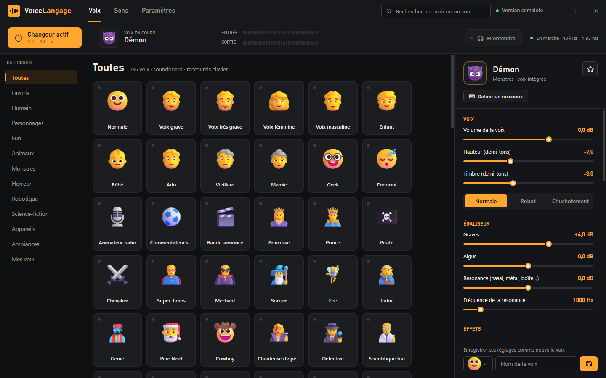

# VoiceLangage

**Changeur de voix en temps réel pour Windows** : 143 voix, une soundboard qui accepte aussi le son de tes vidéos, et des raccourcis clavier qui marchent aussi en jeu. Ta voix transformée part directement dans Discord, tes jeux ou OBS.

## Télécharger

1. Ouvre la section **Releases** (à droite de cette page) et prends la dernière version.
2. Télécharge **`VoiceLangage.exe`**. Il n'y a rien à installer : un double-clic suffit.

> **Windows affiche « Windows a protégé votre ordinateur » ?** C'est normal pour un logiciel qui n'est pas signé par un éditeur payant. Clique sur **Informations complémentaires**, puis sur **Exécuter quand même**.

**Mises à jour** : à partir de la version 1.2.0, VoiceLangage se met à jour tout seul. Quand une nouvelle version sort, un bandeau te propose de l'installer en un clic. Range `VoiceLangage.exe` dans un dossier à toi (Bureau, Documents…), pas dans « Program Files ».

**Configuration requise** : Windows 10 ou 11 (64 bits) et un micro.

## Premier lancement : être entendu sur Discord

1. Dans VoiceLangage, clique sur **« Installer le micro virtuel »**. Il s'agit de VB-Audio Virtual Cable, gratuit, téléchargé depuis son site officiel. Clique ensuite sur **« Install Driver »**. Si le câble n'apparaît pas, redémarre le PC.
2. Dans **Discord** › Paramètres › Voix et vidéo, choisis **« CABLE Output (VB-Audio Virtual Cable) »** comme périphérique d'entrée. Fais pareil dans ton jeu ou dans OBS.
3. Dans Discord, désactive la **suppression de bruit** (Krisp) : elle abîme les voix robot et chuchotées.
4. Choisis une voix et allume le changeur avec le bouton **« Changeur »** en haut à gauche, ou avec **Ctrl + Alt + V**.

## Version gratuite et version complète

| | Gratuite | Complète |
|---|---|---|
| Voix | 10 | **143** |
| Bruitages intégrés de la soundboard | ✓ | ✓ |
| Tes propres sons et le son de tes vidéos (MP3, WAV, MP4, MOV…) | — | ✓ |
| Tes voix perso et réglages avancés | — | ✓ |

Pour passer en version complète, demande une **clé d'activation** à l'auteur. Ensuite, clique sur **Activer une clé** en haut de l'application, colle la clé, puis clique sur **Activer**.

## Fonctionnalités

- **143 voix** en 10 catégories : Humain, Personnages, Fun, Animaux, Monstres, Horreur, Robotique, Science-fiction, Appareils et Ambiances.
- **Hauteur et timbre réglables séparément**, plus les modes robot et chuchotement.
- **Deuxième voix (doublage)** : une octave plus grave, une harmonie, un souffle ou un écho robotique sous ta voix.
- **Effet chanteur** : tes notes sont corrigées sur les notes justes, l'effet « voix autotunée » des rappeurs (voix Rappeur, Pop star, Licorne, Robot chanteur…).\n- **Coupures** : ta voix saute ou bégaie comme une connexion qui lague (voix Connexion pourrie, Disque rayé, Robot en panne…).\n- **Effets** : égaliseur avec résonance, grognement, filtre radio, distorsion, 8-bit, modulation, vibrato, trémolo, chorus, écho et réverbération.
- **Soundboard** : 16 bruitages intégrés (klaxon, ba-dum-tss, applaudissements, pin-pon…), tes propres sons, et le son de tes vidéos (MP4, MOV, MKV, AVI…) par glisser-déposer. Une fenêtre de montage montre la vidéo et la forme du son : tu choisis le passage à garder avec deux poignées.
- **Favoris**, recherche, et voix perso enregistrées automatiquement.
- **M'entendre** : écoute ta voix modifiée dans ton casque.
- **Porte de bruit** : coupe le micro quand tu ne parles pas.
- **Reconnexion automatique** si un casque sans fil s'éteint puis se rallume. L'appli te prévient aussi si ton micro est en sourdine.
- **Mises à jour automatiques et signées** : une version qui ne vient pas de l'auteur est refusée.

## Raccourcis clavier

| Raccourci | Action |
|---|---|
| `Ctrl + Alt + V` | Allumer / couper le changeur de voix |
| `Ctrl + Alt + S` | Arrêter tous les sons |
| Au choix | Chaque voix et chaque son peut avoir son propre raccourci (« Définir un raccourci ») |

## Problèmes fréquents

- **Personne ne m'entend** : vérifie que Discord utilise bien « CABLE Output » comme micro, et que le bandeau « Ton micro est coupé » n'apparaît pas.
- **Léger décalage quand je m'écoute** : c'est normal, environ 90 ms. Le mode « Faible latence » (Paramètres) le réduit.

Tes réglages sont enregistrés dans `%APPDATA%\VoiceLangage`.

## Crédits

- Avatars 3D : [Fluent Emoji](https://github.com/microsoft/fluentui-emoji) de Microsoft (licence MIT).
- Audio : [NAudio](https://github.com/naudio/NAudio) (licence MIT).
- Micro virtuel : [VB-Audio Virtual Cable](https://vb-audio.com/Cable/), donationware de V. Burel. Il n'est pas inclus dans l'application.

Détail des licences : [THIRD-PARTY-NOTICES.md](THIRD-PARTY-NOTICES.md).

---

© 2026 — Tous droits réservés. Le code source de VoiceLangage n'est pas public.
